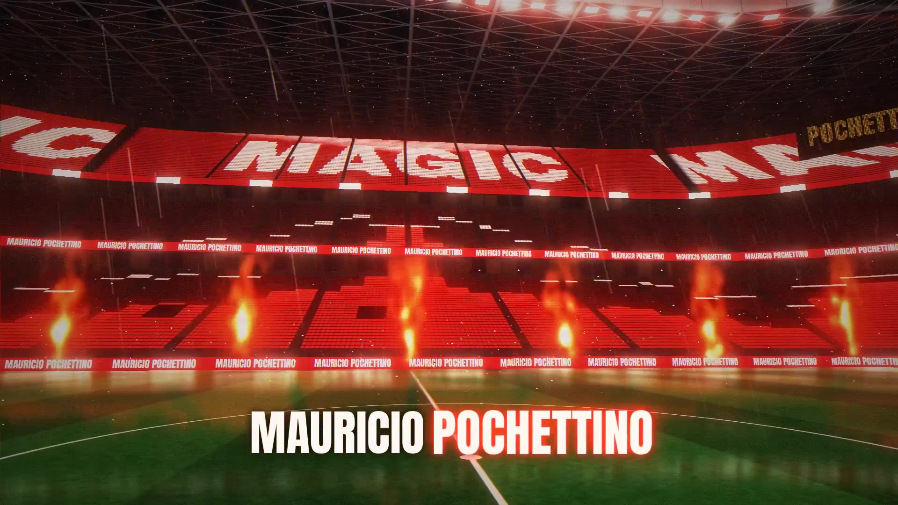
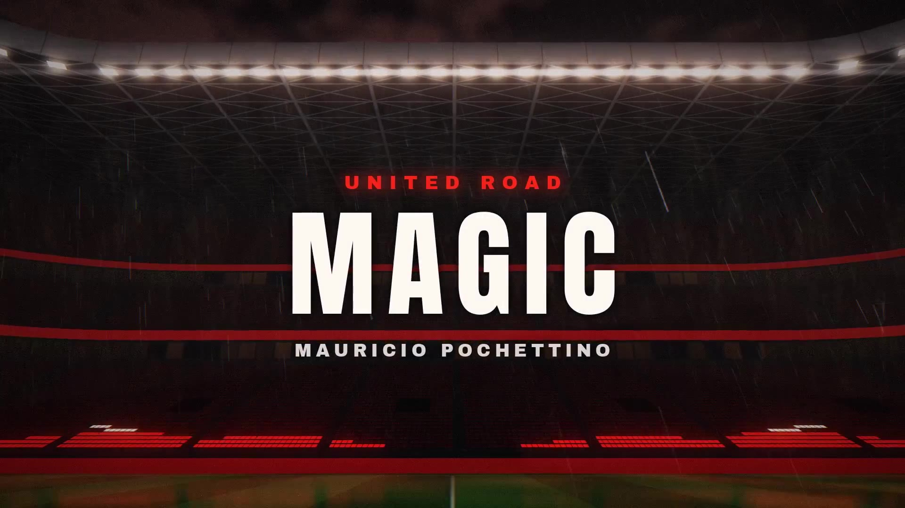
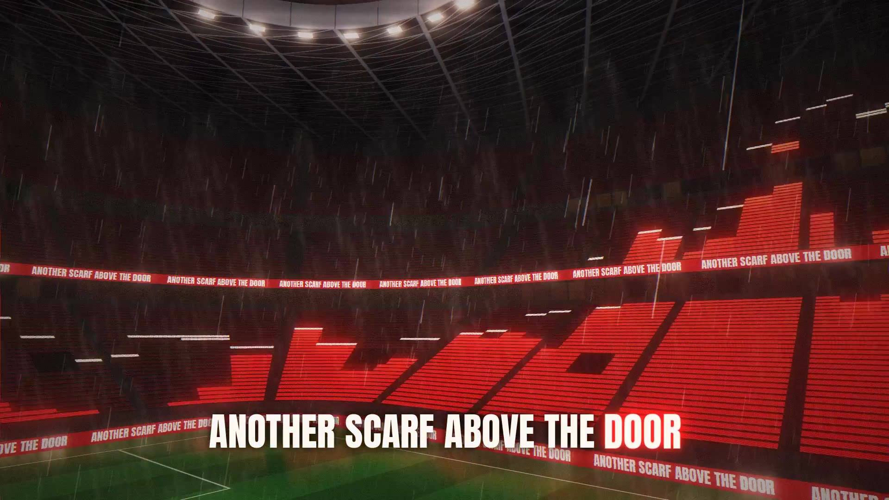
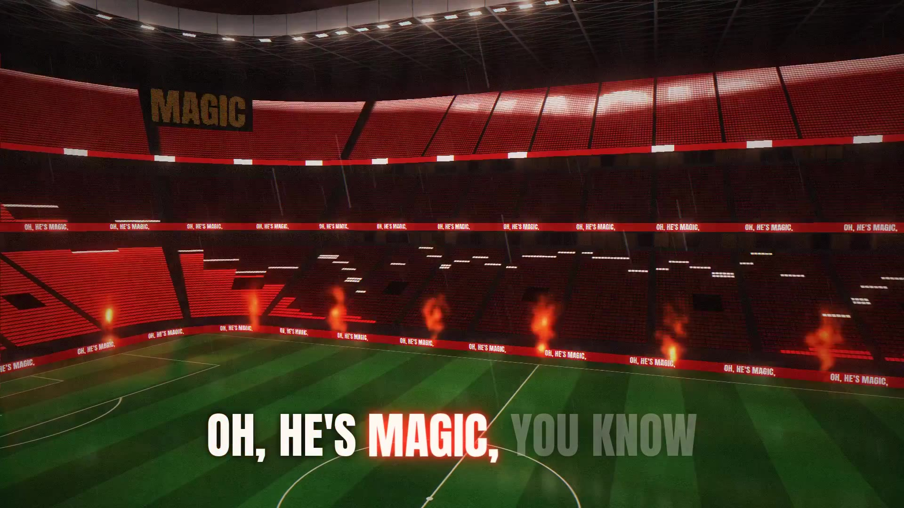
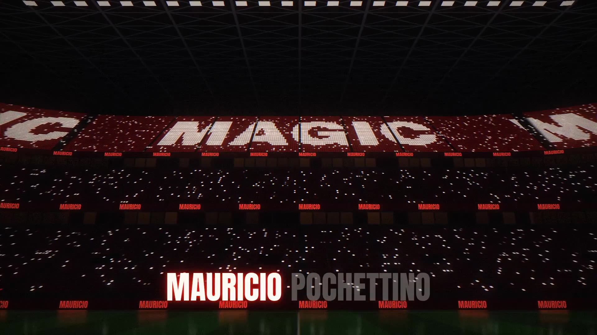

# Old Trafford visualizer: "Magic" (Mauricio Pochettino)

A music visualizer for the United Road Pochettino song. It's a 3D night-time Old Trafford bowl that reacts to the track:

- **Lyrics in sync, word by word.** Every word is timed to the vocal (Whisper + forced alignment, below). The on-screen lyric lights each word as it's sung. The pitchside boards and the ribbon reveal the line word by word, and the corner screens show it word-wrapped.
- **Seats as an equaliser.** Every seat in the bowl lights up in bars (bass in the middle of the far stand).
- **Card display.** In the choruses the upper tier spells out "MAGIC" and "POCHETTINO" round the bowl. The cards flip over in a wave on the exact word.
- **Phone torches.** In the quiet parts (bridge, the stripped-back final chorus, the outro) the floodlights drop and the stands fill with twinkling phone lights.
- **Pyro and ticker tape.** Flame jets fire round the pitch on the beat at every drop, and red and white ticker tape falls through the final chorus.
- **Rain and lights.** Rain falls through the floodlight beams, the pitch is wet and reflective, and the floodlights flash red and white on the tracked beat.
- **Moving camera.** One shot per section, cut on the downbeat: a crane up, a 360° pan, a touchline track, an orbit, a low run along the boards, a push in on the torches, and a big crane for the final chorus.



| | |
|---|---|
|  |  |
|  |  |

## Files

| file | what it is |
|---|---|
| `song.mp3` | the track |
| `lyrics.txt` | lyric sheet as it is actually sung, one display line per row, grouped by `[section]` |
| `lyrics_timing.json` | start and end of every line **and every word** (written by `align_lyrics.py`) |
| `structure.json` | the song's sections, drops and pyro cues, on downbeats (the camera and light show follow it) |
| `align_lyrics.py` | times the lyrics: Demucs vocal → Whisper → wav2vec2 forced alignment → `lyrics_timing.json` |
| `alignment/` | saved Whisper and aligner output, so `align_lyrics.py --reuse` rebuilds the timing in seconds |
| `analyze.py` | audio analysis (bass, spectrum, tracked beats) to `feat.npz` |
| `render_stadium.py` | the renderer (numpy + OpenCV, CPU only) |
| `render.sh` | full render: analysis, parallel chunks, join, add the song |
| `fonts/` | Anton, Archivo Black, DejaVu (open licences included) |

## 1. Lyric timing

`lyrics_timing.json` is already aligned. You only need this section if you change the lyrics or the song.

Whisper alone hears the words well, but on sung vocals its timestamps run early after held notes, sometimes by a second. So `align_lyrics.py` works like WhisperX and cross-checks itself:

1. **Demucs** separates the lead vocal from the band.
2. **Whisper large-v3** (faster-whisper) transcribes the vocal with word timestamps. This finds roughly where each section is sung.
3. **wav2vec2 CTC forced alignment** places every lyric word in its section to about 20 ms. Two acoustic models run (LV60K-960h, plus MMS-FA as a second opinion).
4. A **consensus** step keeps the main model's times. Where a word's first letter got stuck on the previous held note, it moves the word to where the second model puts it.

```bash
pip install -r requirements.txt
pip install torch torchaudio --index-url https://download.pytorch.org/whl/cpu
pip install faster-whisper demucs
python3 align_lyrics.py            # about 10 minutes on 4 CPU cores
python3 align_lyrics.py --reuse    # rebuild from alignment/*.json after editing lyrics.txt line breaks
```

It prints every line with its start time and how well the timing sources agreed. As a check, the word starts land on vocal onsets in the separated vocal: onset strength peaks within 50 ms of the word times. The old estimate was 0.3 s off at best and up to 8 s off in places.

**Write `lyrics.txt` as it's sung.** The aligner places the words it's given. Whisper showed the recording differs from the original sheet in two places:

- The final chorus is sung **three** times, not twice.
- The outro opens with "Oh, he's magic, carried away", not "Said I wouldn't get carried away". Both Whisper passes heard that, and the aligner scored it far higher.

## 2. Song structure

`structure.json` maps the sections from the instrumental stem, snapped to tracked downbeats:

| time | section | what happens |
|---|---|---|
| 0:00 | opening | lights power on, title, soft first chorus |
| 0:20.6 | verse 1 | full band kicks in |
| 0:42.9 | chorus 2 | drop + pyro |
| 1:01.1 | verse 2 | |
| 1:21.4 | chorus 3 | drop + pyro |
| 1:41.7 | bridge | breakdown, phone torches |
| 1:45.7 | hit | 2 bars of full band, strobe + pyro |
| 1:49.7 | bridge | breakdown |
| 1:53.7 | instrumental | full band, pyro |
| 2:01.8 | build | stripped-back final chorus: dark bowl, torches, ramps into the drop |
| 2:15.8 | final | drop: pyro, ticker tape, big crane |
| 2:31.9 | outro | quiet, torches |
| 2:47.7 | end | final hit, lights switch off |

The track's tempo drifts between about 117 and 121 bpm, so the light show follows the tracked beats in `feat.npz`, not a fixed grid.

## 3. Render

```bash
./render.sh                                # writes United_Road_Magic_Old_Trafford.mp4 (1080p30)
python3 render_stadium.py still 6 52 136   # quick check frames at those seconds
CAPTIONS=0 ./render.sh                     # without the on-screen lyric (LED boards only)
```

It takes about 2 s per frame per core. On 4 cores the full 2:50 renders in roughly 45 minutes; more cores split it further (`JOBS=8 ./render.sh`).
